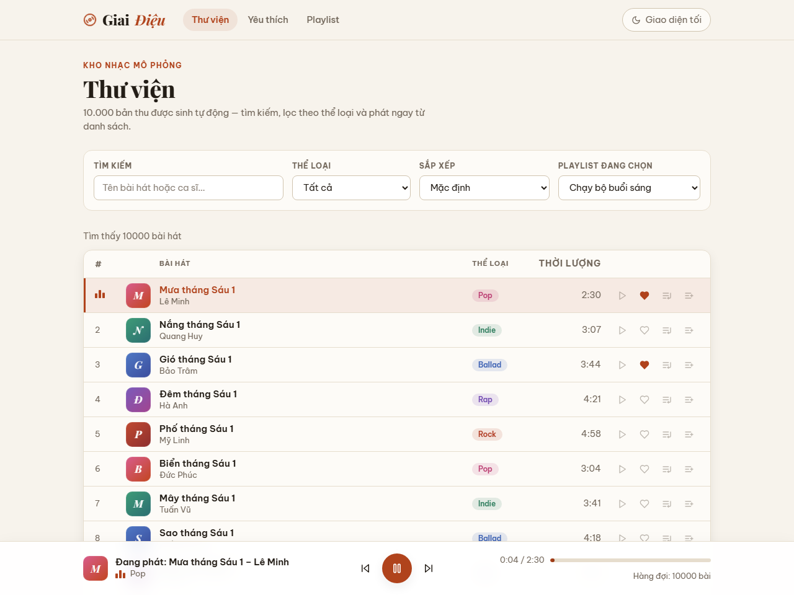
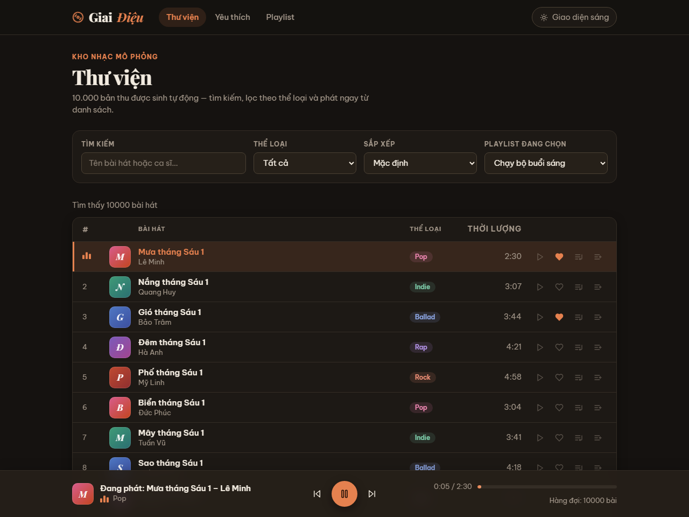
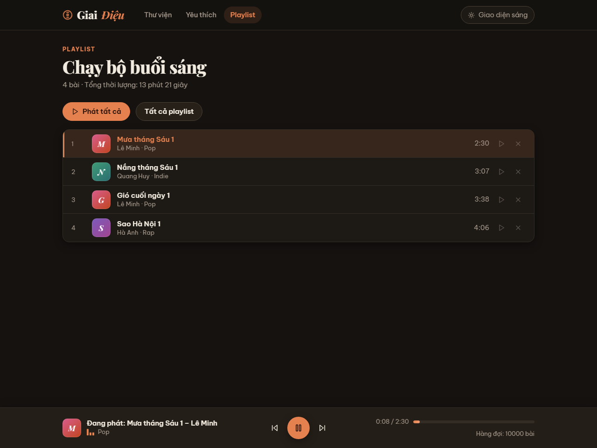
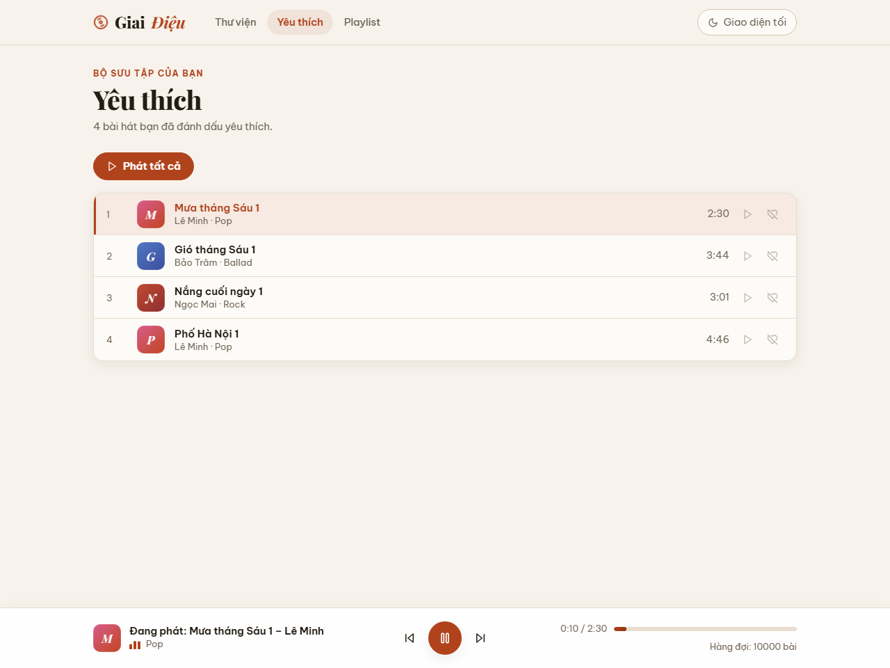
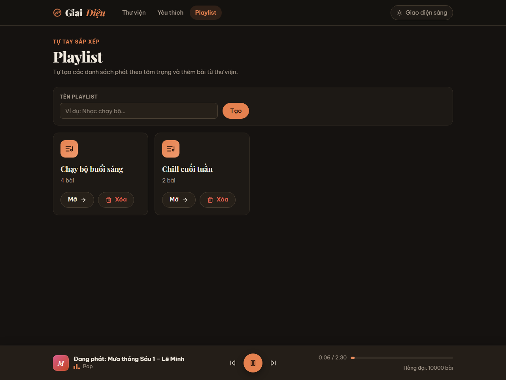
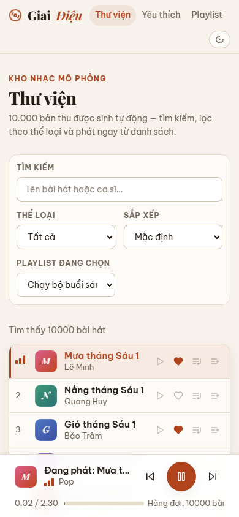
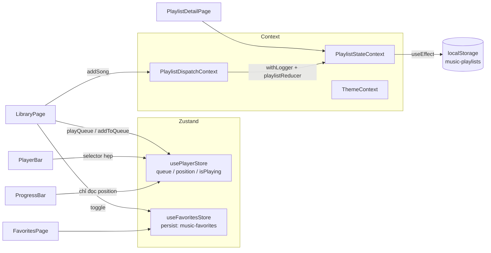

# Giai Điệu — Trình phát nhạc mini

Bài thực hành **TH02 – Lập trình Web nâng cao**: xây dựng một trình phát nhạc
mô phỏng kiểu "Spotify thu nhỏ" với thư viện **10.000 bài hát** cuộn mượt,
thanh phát nhạc chạy theo từng giây, danh sách yêu thích được ghi nhớ và các
playlist tự tạo.

> **Lưu ý:** ứng dụng **mô phỏng** việc phát nhạc — không phát âm thanh thật.
> "Phát nhạc" là một đồng hồ đếm giây (`setInterval` 1000ms) cập nhật thanh
> tiến trình. Dữ liệu bài hát được sinh bằng thuật toán xác định
> (deterministic), không phải dữ liệu âm nhạc có thật.

## Hình ảnh giao diện

Ảnh chụp thật từ ứng dụng đang chạy (`docs/screenshots/`):

| Thư viện — giao diện sáng | Thư viện — giao diện tối |
| --- | --- |
|  |  |

| Chi tiết playlist | Yêu thích |
| --- | --- |
|  |  |

| Danh sách playlist | Mobile 390px |
| --- | --- |
|  |  |

## 1. Chức năng đã triển khai

| Nhóm | Chức năng |
| --- | --- |
| Thư viện (`/`) | Danh sách 10.000 bài ảo hóa bằng `react-window`; tìm kiếm debounce 300ms theo tên bài/ca sĩ (không phân biệt hoa thường); lọc theo thể loại; sắp xếp Mặc định / Tên A–Z (`localeCompare` tiếng Việt) / Thời lượng tăng dần; dòng "Tìm thấy N bài hát"; nút Phát, ♥, + Hàng đợi, + Playlist trên từng dòng |
| Player (mọi trang) | Thanh phát cố định đáy màn hình: "Đang phát: tên bài – ca sĩ", thời gian `0:05 / 2:30`, thanh tiến trình %, nút Trước / Phát-Tạm dừng / Sau, "Hàng đợi: N bài"; `next()` ở bài cuối thì dừng; `prev()` quá 3 giây thì tua về đầu bài |
| Yêu thích (`/favorites`) | Lưu bằng Zustand `persist` key `music-favorites` (giữ sau F5); nút Phát tất cả; trạng thái rỗng có hướng dẫn |
| Playlist (`/playlists`, `/playlists/:id`) | Tạo (validate tên trống/trùng), xóa, thêm/bỏ bài, tổng thời lượng bằng `reduce`, lưu `localStorage` key `music-playlists`; reducer thuần + middleware `withLogger` ghi log action khi DEV |
| Giao diện | Light/dark mode (ThemeContext, lưu lựa chọn); typography Playfair Display + Be Vietnam Pro; "bìa album" màu theo thể loại + chip thể loại; equalizer động ở bài đang phát, đĩa quay trên wordmark, hiệu ứng hover/chuyển trang tinh tế; responsive desktop → điện thoại; trạng thái rỗng/lỗi được thiết kế; hỗ trợ bàn phím và screen reader; tôn trọng `prefers-reduced-motion` |
| Kỹ thuật | Lazy load 3 trang phụ bằng `React.lazy` + `Suspense` (chunk JS riêng khi build); `BUILD_TAG = "mz-4073"` ở dòng đầu `src/App.tsx`; handler ô tìm kiếm tên `handleQueryShift` |

## 2. Công nghệ sử dụng

- **React 18 + TypeScript** (strict, không `any`, không `enum`)
- **Vite 6** — dev server và build
- **React Router DOM v6** — routing, `NavLink` active
- **Zustand 5** — player store + favorites store (middleware `persist`)
- **Context + useReducer** — quản lý playlist (mini-Redux, tách 2 Context)
- **react-window v1** — ảo hóa danh sách (`FixedSizeList`)
- **Vitest 3 + React Testing Library + jsdom + user-event** — kiểm thử
- **lucide-react** — bộ icon nhất quán
- **Google Fonts**: Playfair Display (tiêu đề) + Be Vietnam Pro (nội dung),
  đều hỗ trợ tiếng Việt; khi offline tự rơi về font hệ thống
- CSS thuần với CSS variables (không dùng UI framework)

## 3. Cấu trúc thư mục

```
src/
├── App.tsx              # BUILD_TAG, providers, routes, lazy load
├── main.tsx             # entry, BrowserRouter
├── types.ts             # Genre, Song
├── setupTests.ts        # jest-dom + cleanup sau mỗi test
├── data/
│   └── songs.ts         # generateSongs + SONGS (10.000 bài, sinh 1 lần)
├── utils/
│   └── format.ts        # formatDuration (150 -> "2:30")
├── hooks/
│   └── useDebounce.ts   # hook generic debounce
├── contexts/
│   └── ThemeContext.tsx # light/dark, toggleTheme, value bọc useMemo
├── components/layout/
│   └── AppLayout.tsx    # topbar + NavLink + Suspense + PlayerBar
├── features/
│   ├── library/         # LibraryPage, SongRow (React.memo)
│   ├── player/          # usePlayerStore, PlayerBar, ProgressBar
│   ├── favorites/       # useFavoritesStore (persist), FavoritesPage
│   └── playlists/       # playlistReducer, withLogger, PlaylistContext,
│                        # PlaylistsPage, PlaylistDetailPage
├── test/
│   └── renderWithProviders.tsx  # helper render kèm Provider + MemoryRouter
└── styles/
    └── global.css       # design system (CSS variables, light/dark)
```

Mỗi file nguồn quan trọng có file test `*.test.ts(x)` đặt cạnh.

## 4. Yêu cầu môi trường

- **Node.js ≥ 22.12** (bản LTS 22 hoặc 24 — Vite/Vitest hiện tại không chạy
  trên Node 20 trở xuống). Kiểm tra: `node -v`
- npm (đi kèm Node)

## 5. Cài đặt

```bash
cd music-player
npm install
```

## 6. Chạy ứng dụng

```bash
npm run dev      # mở http://localhost:5173
npm run build    # kiểm tra TypeScript + build production vào dist/
npm run preview  # chạy thử bản build
```

### Trên Windows

Mở **PowerShell** hoặc **Command Prompt**:

```powershell
cd music-player
npm install
npm run dev
```

Nếu dùng nvm-windows và đang ở Node cũ: `nvm install 22` rồi `nvm use 22`.

## 7. Chạy test

```bash
npm test         # vitest run (không watch) — 68 test
```

## 8. Chạy coverage

```bash
npm run coverage
```

Coverage được cấu hình cho `src/features/**` và `src/utils/**` với ngưỡng
**Lines ≥ 70%** (threshold khai báo trong `vite.config.ts`). Kết quả thực tế
khi bàn giao: **Lines 95.34%** (ảnh `coverage.png` ở gốc repo, chụp từ báo cáo
HTML trong thư mục `coverage/`).

## 9. Kiến trúc quản lý state

| Loại state | Công cụ | Lý do |
| --- | --- | --- |
| Bài đang phát, hàng đợi, vị trí (đổi mỗi giây) | Zustand + selector | Đổi liên tục, chỉ component đọc đúng trường mới render lại |
| Bài hát yêu thích | Zustand + `persist` | State nhỏ, cần ghi nhớ sau khi tải lại |
| Playlist (nhiều loại action) | Context + `useReducer`, tách 2 Context | Logic cập nhật phức tạp, không cần thư viện ngoài |
| Giao diện sáng/tối | Context riêng + `useMemo` | Ít thay đổi, dùng toàn ứng dụng |
| Ô tìm kiếm, bộ lọc, form | `useState` cục bộ | Chỉ một component dùng |



## 10. Vì sao 10.000 bài vẫn mượt (virtualization)

`FixedSizeList` của react-window (cao **560px**, mỗi dòng **56px**) chỉ render
khoảng 10–15 dòng đang nằm trong vùng nhìn thấy thay vì 10.000 phần tử DOM.
Khi cuộn, các dòng ra khỏi màn hình được tái sử dụng cho dữ liệu mới. Key của
mỗi dòng là `song.id` (qua `itemKey`), không dùng index, nên React không bị
nhầm identity khi lọc/sắp xếp. Dữ liệu `SONGS` được sinh **một lần** ở module
scope, không sinh lại mỗi render.

## 11. Vì sao ứng dụng không render lại mỗi giây

- Chỉ **`ProgressBar`** subscribe `position`. Mọi component khác dùng selector
  hẹp (`usePlayerStore((s) => s.isPlaying)`, bài hiện tại, độ dài hàng đợi…)
  nên khi `tick()` chạy mỗi giây, chỉ vùng thời gian/thanh tiến trình cập nhật.
- `SongRow` bọc `React.memo`; mọi callback truyền xuống đều qua `useCallback`
  và gói trong `itemData` được `useMemo`. Khi người dùng **đang gõ** tìm kiếm,
  danh sách lọc theo giá trị đã debounce nên `itemData` không đổi → không dòng
  nào render lại trước khi hết 300ms.
- `setInterval` chỉ được tạo khi `isPlaying === true` và luôn được
  `clearInterval` khi tạm dừng/unmount — không có interval rò rỉ.

## 12. Đối chiếu các yêu cầu trong đề (cách tự kiểm tra)

1. Mở `/` → "Tìm thấy 10000 bài hát"; DevTools ▸ Elements chỉ thấy ~10–15
   `.song-row` trong DOM.
2. Gõ `mưa` → trong lúc gõ danh sách chưa đổi; sau 300ms → "Tìm thấy 1250 bài
   hát". Chọn thể loại Rock → "Tìm thấy 250 bài hát". Gõ `thu hà` (bỏ lọc) →
   "Tìm thấy 1000 bài hát". Gõ `xyz` → "Không tìm thấy bài hát nào".
3. Sắp xếp Tên A–Z, xóa bộ lọc → dòng đầu là "Biển bình yên 1".
4. Bấm Phát ở s1 → "Đang phát: Mưa tháng Sáu 1 – Lê Minh", "0:00 / 2:30", sau
   5 giây "0:05 / 2:30"; Tạm dừng → thời gian đứng yên; Sau → sang "Nắng tháng
   Sáu 1 – Quang Huy".
5. Gõ `mưa`, Phát dòng đầu, bấm Sau → bài tiếp theo vẫn chứa "Mưa" (hàng đợi
   là danh sách đã lọc).
6. Bấm ♥ ở s1, s3 → mở `/favorites`, F5 → vẫn còn 2 bài; Local Storage có key
   `music-favorites`.
7. Tạo playlist "Chạy bộ" rồi tạo "chạy bộ" → "Tên playlist đã tồn tại". Thêm
   s1, s2, rồi s1 lần nữa → playlist chỉ có 2 bài, chi tiết hiện "Tổng thời
   lượng: 5 phút 37 giây"; Console (DEV) thấy log action `addSong` kèm state
   trước/sau.
8. Tab Network: lần đầu mở trang Playlist thấy tải thêm chunk JS riêng
   (`PlaylistsPage-*.js`).
9. Nút "Giao diện tối/Giao diện sáng" chuyển theme toàn ứng dụng, giữ sau F5.

Phần lớn các hành vi trên cũng được kiểm chứng tự động trong 68 test
(`npm test`).

## 13. Giới hạn có chủ đích

- Không phát âm thanh thật, không có file nhạc — đúng yêu cầu mô phỏng.
- Dữ liệu bài hát là giả lập sinh bằng công thức; tên ca sĩ/bài hát không ứng
  với nghệ sĩ có thật.
- Không có backend/API — toàn bộ dữ liệu nằm phía client (`localStorage`).
- Chưa có: phát ngẫu nhiên, lặp lại, kéo-thả sắp xếp playlist, phím tắt Space
  (các mục "thử thách thêm" không bắt buộc của đề).
- Danh sách trang Yêu thích và chi tiết Playlist không ảo hóa (đề không yêu
  cầu, số lượng bài thường nhỏ).
- Tên bài hát được giữ **nguyên theo thuật toán bắt buộc của đề**
  (`Mưa tháng Sáu 1`, `Biển bình yên 1`…) — bảng tự kiểm tra và test chấm
  điểm dựa vào đúng các tên/số lượng này nên không được thay đổi. Phần "bìa
  album" là ô màu trang trí sinh từ thể loại, không phải ảnh thật.

## 14. Ghi chú bàn giao

- 4 commit theo đề: `Phan 1` → `Phan 4`, cộng commit hoàn thiện UI/README.
- `npm run build`, `npm test`, `npm run coverage` đều đã chạy thành công trên
  Node 22 (Windows) trước khi bàn giao; coverage Lines 95.34% ≥ 70%.
- `coverage.png` được chụp từ báo cáo coverage thật (headless Chrome chụp
  `coverage/index.html`).
